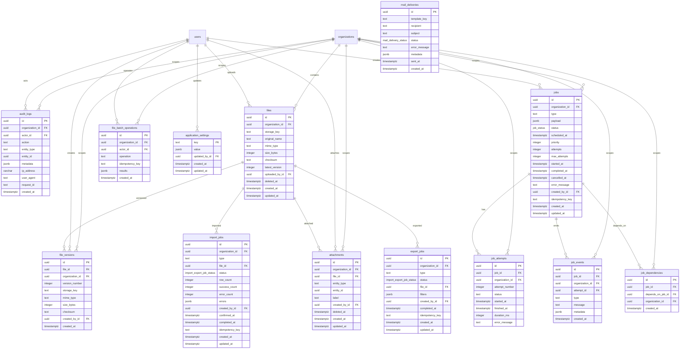
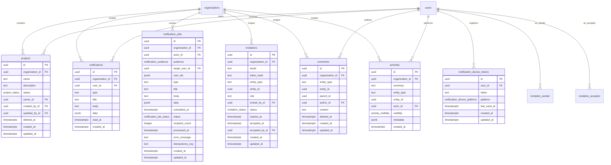

# ERD

## Identity Domain

```mermaid
erDiagram
  organizations ||--o{ organization_members : has
  organizations ||--o{ roles : has
  organizations ||--o{ user_roles : scopes
  organizations ||--o{ projects : contains
  organizations ||--o{ notifications : scopes
  organizations ||--o{ invitations : scopes
  organizations ||--o{ audit_logs : scopes
  organizations ||--o{ files : contains
  organizations ||--o{ jobs : scopes
  organizations ||--o{ comments : scopes
  organizations ||--o{ activities : scopes
  users ||--o{ organization_members : belongs_to
  users ||--o{ auth_sessions : has
  users ||--o{ email_verification_tokens : owns
  users ||--o{ password_reset_tokens : owns
  users ||--o{ user_roles : assigned
  users ||--o{ user_two_factor_secrets : has
  users ||--o{ user_recovery_codes : has
  users ||--o{ mfa_challenges : has
  users ||--o{ external_identities : has
  users ||--o{ user_preferences : has
  users ||--o{ projects : owns
  users ||--o{ notifications : receives
  users ||--o{ notification_device_tokens : registers
  users ||--o{ notification_jobs : creates
  users ||--o{ invitations : sends
  users ||--o{ audit_logs : acts
  users ||--o{ comments : authors
  users ||--o{ activities : performs
  users ||--o{ files : uploads
  roles ||--o{ user_roles : linked
  roles ||--o{ role_permissions : grants
  permissions ||--o{ role_permissions : linked
  files ||--o{ file_versions : versioned
  files ||--o{ attachments : attached
  jobs ||--o{ job_attempts : has
  jobs ||--o{ job_events : emits
  jobs ||--o{ job_dependencies : depends_on

  organizations {
    uuid id PK
    text name
    text slug
    timestamptz deleted_at
    timestamptz created_at
    timestamptz updated_at
  }

  organization_members {
    uuid id PK
    uuid organization_id FK
    uuid user_id FK
    organization_member_role role
    timestamptz created_at
    timestamptz updated_at
  }

  users {
    uuid id PK
    text email
    text password_hash
    text display_name
    text avatar_url
    uuid avatar_file_id
    user_status status
    timestamptz email_verified_at
    timestamptz deleted_at
    timestamptz created_at
    timestamptz updated_at
  }

  auth_sessions {
    uuid id PK
    uuid user_id FK
    text refresh_token_hash
    timestamptz expires_at
    timestamptz revoked_at
    timestamptz last_used_at
    varchar ip_address
    text user_agent
    timestamptz created_at
    timestamptz updated_at
  }

  email_verification_tokens {
    uuid id PK
    uuid user_id FK
    text token_hash
    timestamptz expires_at
    timestamptz used_at
    timestamptz created_at
  }

  password_reset_tokens {
    uuid id PK
    uuid user_id FK
    text token_hash
    timestamptz expires_at
    timestamptz used_at
    timestamptz created_at
  }

  roles {
    uuid id PK
    uuid organization_id FK
    text name
    text description
    boolean is_system
    timestamptz created_at
    timestamptz updated_at
  }

  permissions {
    uuid id PK
    text name
    text description
    boolean is_system
    timestamptz created_at
    timestamptz updated_at
  }

  user_roles {
    uuid user_id FK
    uuid organization_id FK
    uuid role_id FK
    timestamptz assigned_at
  }

  role_permissions {
    uuid role_id FK
    uuid permission_id FK
    timestamptz assigned_at
  }

  user_two_factor_secrets {
    uuid user_id PK, FK
    text secret_ciphertext
    text secret_iv
    text secret_auth_tag
    boolean enabled
    timestamptz confirmed_at
    timestamptz created_at
    timestamptz updated_at
  }

  user_recovery_codes {
    uuid id PK
    uuid user_id FK
    text code_hash
    timestamptz used_at
    timestamptz created_at
  }

  mfa_challenges {
    uuid id PK
    uuid user_id FK
    text token_hash
    integer attempts
    timestamptz expires_at
    timestamptz consumed_at
    text ip_address
    text user_agent
    timestamptz created_at
  }

  external_identities {
    uuid id PK
    uuid user_id FK
    text provider
    text provider_subject
    text email
    timestamptz created_at
    timestamptz updated_at
  }

  sso_login_states {
    uuid id PK
    text provider
    text state_hash
    text nonce
    text code_verifier
    text redirect_uri
    timestamptz expires_at
    timestamptz consumed_at
    timestamptz created_at
  }

  sso_session_exchanges {
    uuid id PK
    text code_hash
    text access_token
    text refresh_token
    text organization_id
    timestamptz expires_at
    timestamptz consumed_at
    timestamptz created_at
  }

  user_preferences {
    uuid user_id PK, FK
    text theme
    text language
    text timezone
    jsonb notification_preferences
    jsonb email_preferences
    timestamptz created_at
    timestamptz updated_at
  }
```

## Platform Domain

## Workspace Domain

## Counts

- **37 tables** across 3 domains (Identity: 17, Platform: 13, Workspace: 7)
- **2 PostgreSQL enums** in identity: `user_status`, `organization_member_role`
- **3 enums** in platform: `mail_delivery_status`, `job_status`, `import_export_job_status`
- **5 enums** in workspace: `project_status`, `notification_device_platform`, `notification_audience`, `notification_job_status`, `invitation_status`, `activity_visibility`
- Tenancy is centered on `organizations` — most data tables carry a scoping `organization_id` FK
