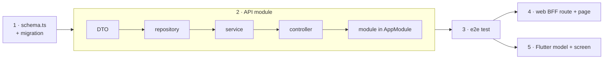

# Add a feature

This walk-through adds **notes**: each signed-in user can create, list and
delete their own notes, from the web app and the mobile app. It touches every
layer once — schema, API module, tests, web BFF and page, Flutter — and is the
pattern to copy for your own features. Every snippet below was built, type
checked and tested against this template.



## 1. Schema and migration

Add the table to `packages/db/src/schema.ts`:

```ts
export const notes = pgTable(
  "notes",
  {
    id: uuid("id").primaryKey().defaultRandom(),
    userId: uuid("user_id")
      .notNull()
      .references(() => users.id, { onDelete: "cascade" }),
    title: text("title").notNull(),
    body: text("body").notNull(),
    createdAt: timestamp("created_at", { withTimezone: true }).notNull().defaultNow(),
  },
  (table) => [index("notes_user_idx").on(table.userId, table.createdAt)],
);

export type NoteRow = typeof notes.$inferSelect;
```

Generate and apply the migration, then commit the new SQL file and the
`meta/` snapshot:

```bash
bun run db:generate   # → packages/db/migrations/0006_<name>.sql
bun run db:migrate
```

## 2. The API module

Add an error code to `apps/api/src/shared/errors.ts`:

```ts
NOTE_NOT_FOUND: "NOTE_NOT_FOUND",
```

Create `apps/api/src/modules/notes/` with four files.

**`notes.dto.ts`** — what the client may send and what it gets back:

```ts
import { IsString, MaxLength, MinLength } from "class-validator";

export class CreateNoteDto {
  @IsString()
  @MinLength(1)
  @MaxLength(200)
  title!: string;

  @IsString()
  @MaxLength(10_000)
  body!: string;
}

export interface NoteDto {
  id: string;
  title: string;
  body: string;
  createdAt: string;
}
```

**`notes.repository.ts`** — every query the feature owns. Scope by owner in the
query itself:

```ts
import { Inject, Injectable } from "@nestjs/common";
import { and, desc, eq } from "drizzle-orm";
import { notes, type NoteRow } from "@lean/db";

import { DatabaseService } from "../../shared/database.service";

export interface CreateNoteInput {
  title: string;
  body: string;
}

@Injectable()
export class NotesRepository {
  constructor(@Inject(DatabaseService) private readonly database: DatabaseService) {}

  async create(userId: string, input: CreateNoteInput): Promise<NoteRow> {
    const [row] = await this.database.db
      .insert(notes)
      .values({ userId, ...input })
      .returning();

    if (!row) {
      throw new Error("Note insert returned no row");
    }

    return row;
  }

  listForUser(userId: string): Promise<NoteRow[]> {
    return this.database.db
      .select()
      .from(notes)
      .where(eq(notes.userId, userId))
      .orderBy(desc(notes.createdAt))
      .limit(100);
  }

  /** Scoped to the owner: someone else's note is "not found", never "forbidden". */
  async remove(id: string, userId: string): Promise<boolean> {
    const deleted = await this.database.db
      .delete(notes)
      .where(and(eq(notes.id, id), eq(notes.userId, userId)))
      .returning({ id: notes.id });

    return deleted.length > 0;
  }
}
```

**`notes.service.ts`** — the behaviour: map rows to DTOs, turn "nothing
deleted" into a 404:

```ts
import { HttpStatus, Inject, Injectable } from "@nestjs/common";
import type { NoteRow } from "@lean/db";

import { AppError, ERROR_CODES } from "../../shared/errors";
import type { NoteDto } from "./notes.dto";
import { NotesRepository, type CreateNoteInput } from "./notes.repository";

const toNoteDto = (row: NoteRow): NoteDto => ({
  id: row.id,
  title: row.title,
  body: row.body,
  createdAt: row.createdAt.toISOString(),
});

@Injectable()
export class NotesService {
  constructor(@Inject(NotesRepository) private readonly notes: NotesRepository) {}

  async list(userId: string): Promise<NoteDto[]> {
    return (await this.notes.listForUser(userId)).map(toNoteDto);
  }

  async create(userId: string, input: CreateNoteInput): Promise<NoteDto> {
    return toNoteDto(await this.notes.create(userId, input));
  }

  async remove(id: string, userId: string): Promise<void> {
    if (!(await this.notes.remove(id, userId))) {
      throw new AppError(ERROR_CODES.NOTE_NOT_FOUND, "Note not found", HttpStatus.NOT_FOUND);
    }
  }
}
```

**`notes.controller.ts`** — routes and validation only. Authentication is
global, so every route here requires a signed-in user; add
`@UseGuards(RolesGuard)` + `@Roles("ADMIN")` for admin-only routes:

```ts
import {
  Body,
  Controller,
  Delete,
  Get,
  HttpCode,
  Inject,
  Param,
  ParseUUIDPipe,
  Post,
} from "@nestjs/common";

import { CurrentUser, type RequestUser } from "../../shared/current-user.decorator";
import { validate } from "../../shared/validation";
import { CreateNoteDto, type NoteDto } from "./notes.dto";
import { NotesService } from "./notes.service";

@Controller("notes")
export class NotesController {
  constructor(@Inject(NotesService) private readonly notes: NotesService) {}

  @Get()
  async list(@CurrentUser() user: RequestUser): Promise<{ data: NoteDto[] }> {
    return { data: await this.notes.list(user.userId) };
  }

  @Post()
  @HttpCode(201)
  async create(
    @CurrentUser() user: RequestUser,
    @Body(validate(CreateNoteDto)) input: CreateNoteDto,
  ): Promise<{ data: NoteDto }> {
    return { data: await this.notes.create(user.userId, input) };
  }

  @Delete(":id")
  @HttpCode(204)
  async remove(
    @CurrentUser() user: RequestUser,
    @Param("id", ParseUUIDPipe) id: string,
  ): Promise<void> {
    await this.notes.remove(id, user.userId);
  }
}
```

**`notes.module.ts`**, then add `NotesModule` to `imports` in
`apps/api/src/app.module.ts`:

```ts
import { Module } from "@nestjs/common";

import { NotesController } from "./notes.controller";
import { NotesRepository } from "./notes.repository";
import { NotesService } from "./notes.service";

@Module({
  controllers: [NotesController],
  providers: [NotesRepository, NotesService],
})
export class NotesModule {}
```

Try it (the dev server reloads on save):

```bash
curl -s -X POST localhost:3001/api/v1/notes -H "authorization: Bearer $TOKEN" \
  -H 'content-type: application/json' -d '{"title":"Groceries","body":"milk, eggs"}'
# {"data":{"id":"bf08…","title":"Groceries","body":"milk, eggs","createdAt":"…"}}
```

## 3. An HTTP test

`apps/api/test/notes.e2e.spec.ts` boots the real app with an in-memory
repository, so it needs no database. Cover the failure paths, not just the
happy one:

```ts
import type { INestApplication } from "@nestjs/common";
import type { NoteRow } from "@lean/db";

import request from "supertest";
import { afterAll, beforeAll, describe, expect, it } from "vitest";

import { NotesRepository, type CreateNoteInput } from "../src/modules/notes/notes.repository";
import { InMemoryAuthRepository, createTestApp, makeUser, signToken } from "./support";

class InMemoryNotesRepository {
  readonly rows: NoteRow[] = [];

  async create(userId: string, input: CreateNoteInput): Promise<NoteRow> {
    const row = { id: crypto.randomUUID(), userId, createdAt: new Date(), ...input };
    this.rows.push(row);
    return row;
  }

  async listForUser(userId: string): Promise<NoteRow[]> {
    return this.rows.filter((row) => row.userId === userId);
  }

  async remove(id: string, userId: string): Promise<boolean> {
    const index = this.rows.findIndex((row) => row.id === id && row.userId === userId);
    if (index < 0) return false;
    this.rows.splice(index, 1);
    return true;
  }
}

describe("notes (e2e)", () => {
  let app: INestApplication;
  const auth = new InMemoryAuthRepository();
  const alice = auth.add(makeUser()).id;
  const bob = auth.add(makeUser()).id;

  const as = (userId: string, method: "get" | "post" | "delete", path: string) =>
    request(app.getHttpServer())
      [method](`/api/v1${path}`)
      .set("authorization", `Bearer ${signToken(userId)}`);

  beforeAll(async () => {
    app = await createTestApp(
      (builder) =>
        builder.overrideProvider(NotesRepository).useValue(new InMemoryNotesRepository()),
      auth,
    );
  });

  afterAll(async () => {
    await app.close();
  });

  it("creates a note and lists it for its owner only", async () => {
    const created = await as(alice, "post", "/notes")
      .send({ title: "Groceries", body: "milk" })
      .expect(201);

    expect(created.body.data).toMatchObject({ title: "Groceries", body: "milk" });
    expect((await as(alice, "get", "/notes").expect(200)).body.data).toHaveLength(1);
    expect((await as(bob, "get", "/notes").expect(200)).body.data).toHaveLength(0);
  });

  it("rejects an empty title", async () => {
    const response = await as(alice, "post", "/notes").send({ title: "", body: "" }).expect(400);

    expect(response.body.error.code).toBe("VALIDATION_FAILED");
  });

  it("answers 404 when deleting someone else's note", async () => {
    const created = await as(alice, "post", "/notes").send({ title: "Mine", body: "" });
    const response = await as(bob, "delete", `/notes/${created.body.data.id}`).expect(404);

    expect(response.body.error.code).toBe("NOTE_NOT_FOUND");
    await as(alice, "delete", `/notes/${created.body.data.id}`).expect(204);
  });

  it("requires a signed-in user", async () => {
    await request(app.getHttpServer()).get("/api/v1/notes").expect(401);
  });
});
```

```bash
(cd apps/api && bunx vitest run test/notes.e2e.spec.ts)
```

## 4. Web: BFF routes and a page

The browser cannot call the API directly (it has no token), so expose the
routes through the web app's BFF. `apps/web/app/api/notes/route.ts`:

```ts
import type { NextRequest } from "next/server";
import type { NextResponse } from "next/server";

import { badOrigin, proxyWithSession } from "@lean/next-bff";

import { isSameOrigin } from "@/lib/is-same-origin";

export async function GET(request: NextRequest): Promise<NextResponse> {
  return proxyWithSession(request, "/notes");
}

export async function POST(request: NextRequest): Promise<NextResponse> {
  if (!isSameOrigin(request)) {
    return badOrigin();
  }

  return proxyWithSession(request, "/notes", { method: "POST", body: await request.text() });
}
```

`apps/web/app/api/notes/[id]/route.ts`:

```ts
import type { NextRequest } from "next/server";
import type { NextResponse } from "next/server";

import { badOrigin, proxyWithSession } from "@lean/next-bff";

import { isSameOrigin } from "@/lib/is-same-origin";

interface Context {
  params: Promise<{ id: string }>;
}

export async function DELETE(request: NextRequest, context: Context): Promise<NextResponse> {
  if (!isSameOrigin(request)) {
    return badOrigin();
  }

  const { id } = await context.params;

  return proxyWithSession(request, `/notes/${encodeURIComponent(id)}`, { method: "DELETE" });
}
```

The page, `apps/web/app/notes/page.tsx`:

```tsx
"use client";

import { useRouter } from "next/navigation";
import { useCallback, useEffect, useState, type FormEvent } from "react";
import { errorMessage, sendJson, sessionFetch } from "@lean/next-bff/client";

import { Button } from "@/components/ui/button";
import { Card, CardContent, CardHeader, CardTitle } from "@/components/ui/card";
import { Input } from "@/components/ui/input";

interface Note {
  id: string;
  title: string;
  body: string;
}

export default function NotesPage() {
  const router = useRouter();
  const [notes, setNotes] = useState<Note[]>([]);
  const [title, setTitle] = useState("");
  const [error, setError] = useState<string | null>(null);

  const load = useCallback(async () => {
    const response = await sessionFetch("/api/notes");
    if (response.status === 401) return router.replace("/login");
    if (response.ok) setNotes(((await response.json()) as { data: Note[] }).data);
  }, [router]);

  useEffect(() => {
    void load();
  }, [load]);

  async function add(event: FormEvent): Promise<void> {
    event.preventDefault();
    const response = await sendJson("/api/notes", "POST", { title, body: "" });
    if (!response.ok) return setError(await errorMessage(response, "Could not save"));
    setTitle("");
    setError(null);
    await load();
  }

  async function remove(id: string): Promise<void> {
    await sendJson(`/api/notes/${id}`, "DELETE");
    await load();
  }

  return (
    <main className="mx-auto w-full max-w-3xl space-y-6 p-6">
      <Card>
        <CardHeader>
          <CardTitle>Notes</CardTitle>
        </CardHeader>
        <CardContent className="space-y-4">
          <form onSubmit={(event) => void add(event)} className="flex gap-2">
            <Input value={title} onChange={(event) => setTitle(event.target.value)} />
            <Button type="submit">Add</Button>
          </form>
          {error ? <p className="text-sm text-destructive">{error}</p> : null}
          <ul className="divide-y">
            {notes.map((note) => (
              <li key={note.id} className="flex items-center justify-between py-2">
                {note.title}
                <Button variant="outline" size="sm" onClick={() => void remove(note.id)}>
                  Delete
                </Button>
              </li>
            ))}
          </ul>
        </CardContent>
      </Card>
    </main>
  );
}
```

Finally, send signed-out visitors to the login page by adding the path to the
matcher in `apps/web/proxy.ts`:

```ts
export const config = {
  matcher: ["/account", "/notes"],
};
```

For an admin screen, do the same under `apps/admin` and put the API route
behind `@Roles("ADMIN")`.

## 5. Mobile

Add a model to `apps/mobile/lib/models.dart`:

```dart
class Note {
  Note.fromJson(Map<String, dynamic> json)
      : id = json['id'] as String,
        title = json['title'] as String,
        body = json['body'] as String;

  final String id;
  final String title;
  final String body;
}
```

and two calls to `ApiClient` in `apps/mobile/lib/api.dart`:

```dart
Future<List<Note>> notes() async {
  final body = await _expect(
      () => _client.get(_uri('/notes'), headers: _auth()),
      'Could not load notes');

  return (body['data'] as List<dynamic>)
      .map((item) => Note.fromJson(item as Map<String, dynamic>))
      .toList();
}

Future<void> addNote(String title, String text) => _expect(
    () => _client.post(_uri('/notes'),
        headers: {..._auth(), 'content-type': 'application/json'},
        body: jsonEncode({'title': title, 'body': text})),
    'Could not save the note');
```

Build the screen like `lib/screens/notifications_screen.dart` (a
`RefreshIndicator` around a `ListView`) and link it from `home_screen.dart`.
Write a widget test with `MockClient` like `test/screens_test.dart`.

## 6. Done means

```bash
bun run check
bun run format:check
cd apps/mobile && flutter analyze && flutter test
```

## Checklist

- [ ] Schema change → new migration, committed with its snapshot
- [ ] Repository scopes every query by owner where data is private
- [ ] Controller validates with `validate(Dto)`; service throws `AppError` with a new code
- [ ] e2e test covers the 400, 401, 404 paths
- [ ] Every BFF write checks `isSameOrigin`
- [ ] New private pages added to the `proxy.ts` matcher
- [ ] Files ≤ 300 lines, functions ≤ 60 lines (ESLint enforces it)
