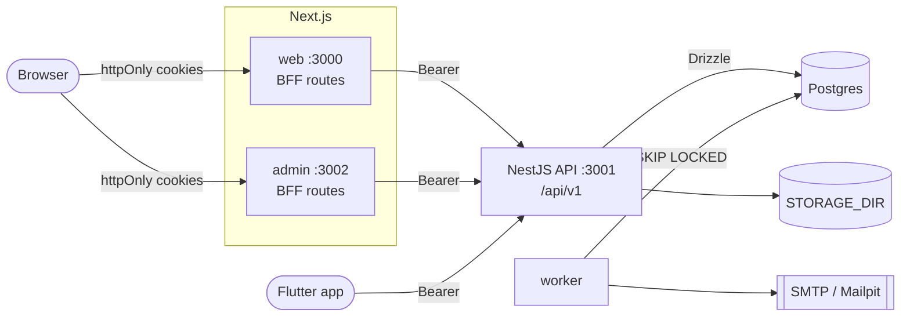
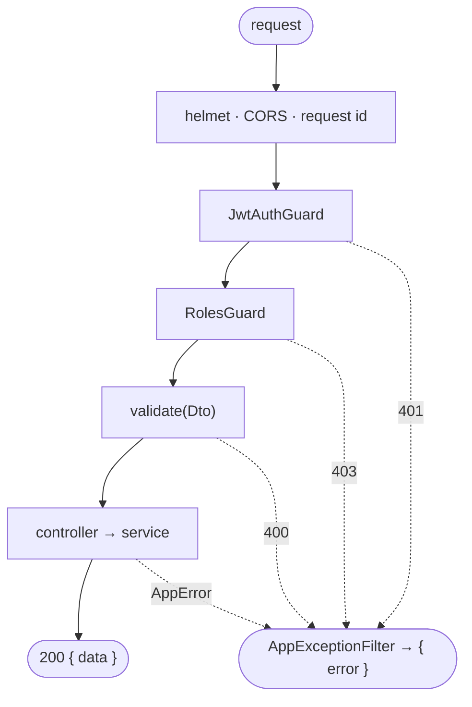
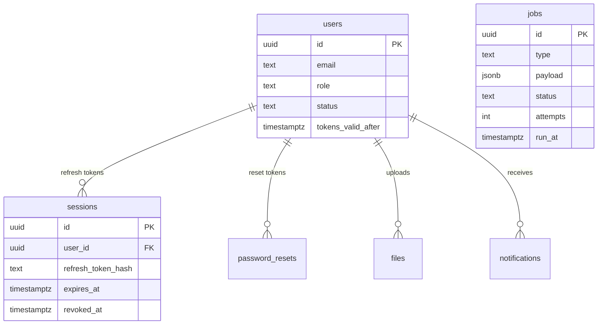

# Architecture

```
apps/
  api/      NestJS HTTP API (port 3001, prefix /api/v1)
  worker/   job runner: claims rows from the jobs table
  web/      Next.js public app + BFF route handlers (port 3000)
  admin/    Next.js admin console + BFF route handlers (port 3002)
  mobile/   Flutter client (Android, iOS)
packages/
  db/        Drizzle schema, migrations, seed, queue helpers, password hashing
  config/    Zod environment schemas (api, worker, mail)
  next-bff/  cookie session + API proxy shared by web and admin
docs/        this site + CONVENTIONS.md
```



- Browsers never hold tokens. The Next.js apps keep them in `httpOnly` cookies
  and forward requests to the API from their own route handlers (the BFF).
- Mobile talks to the API directly and keeps its refresh token in the
  platform keychain.
- The API never sends mail itself. It inserts a `mail.send` job in the same
  database; the worker delivers it.

## Backend features are folders

```
apps/api/src/modules/<feature>/
  <feature>.module.ts       Nest wiring
  <feature>.controller.ts   route + validation; no business rules
  <feature>.service.ts      the behaviour; one method per operation
  <feature>.repository.ts   every query this feature owns
  <feature>.dto.ts          request/response shapes
  __tests__/                specs next to the code
```

Current features: `auth`, `users`, `files`, `jobs`, `notifications`, `mail`.
Shared infrastructure lives in `apps/api/src/shared/`: the database service,
the exception filter, error codes, the validation pipe factory, the roles
guard, request logging and local storage.

Dependencies point one way. A feature never imports another feature's
repository; it goes through the other feature's exported service. For example,
`PasswordService` queues the reset mail through `MailService`, which enqueues
through `JobsService`.

[Add a feature](./add-a-feature) walks through a new module end to end.

## Request pipeline



Every request to the API passes, in order:

1. `helmet` security headers and CORS (`CORS_ORIGINS`).
2. Request id: reuses a valid incoming `x-request-id` or creates one, echoes it
   in the response and in every log line.
3. `JwtAuthGuard` (global): skips routes marked `@Public()`, otherwise verifies
   the bearer token and loads the user from the database.
4. `RolesGuard` on admin routes (`@Roles("ADMIN")`).
5. `validate(Dto)` on bodies and queries: unknown properties are rejected.
6. The controller returns `{ data }`; `AppExceptionFilter` turns every thrown
   error into `{ error: { code, message } }`.

## Data

Schema: `packages/db/src/schema.ts`.



| Table             | Holds                                                             |
| ----------------- | ----------------------------------------------------------------- |
| `users`           | email, password hash, role, status, `tokens_valid_after`          |
| `sessions`        | one row per refresh token (hash only), with expiry and revocation |
| `password_resets` | hashed single-use reset tokens, one hour lifetime                 |
| `jobs`            | the queue: type, payload, status, attempts, `run_at`, last error  |
| `files`           | upload metadata; bytes live under `STORAGE_DIR`                   |
| `notifications`   | per-user in-app messages with `read_at`                           |

A schema change is a new migration:

```bash
bun run db:generate   # writes packages/db/migrations/NNNN_*.sql from schema.ts
bun run db:migrate
```

Never edit an applied migration. Commit the generated SQL and the `meta/`
snapshot together.

## Transactions

`DatabaseService.transaction(work)` keeps the open transaction in
`AsyncLocalStorage`. Every repository call made through `database.db` inside
`work` joins it, even across features. Use it whenever an operation writes more
than once (for example, creating a user and the welcome notification, or
storing a reset token and queueing its mail).

## Two tracks

| Branch | Purpose                                                                            |
| ------ | ---------------------------------------------------------------------------------- |
| `main` | this lean template                                                                 |
| `max`  | the full enterprise template (plugin architecture, multi-tenant, SSO/MFA, codegen) |

The `max` track keeps its [Architecture Wiki](https://2tsoftwareapp.github.io/super-template/docs-wiki/), published alongside this site.
