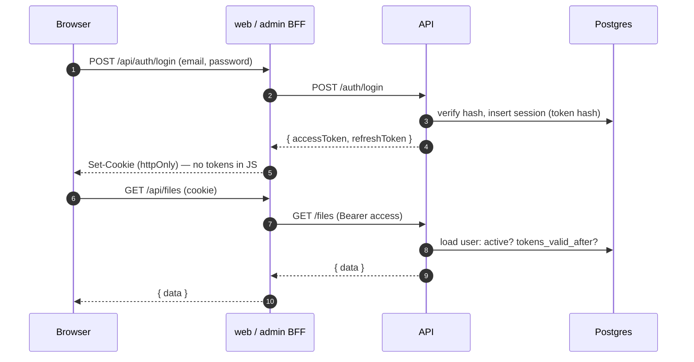
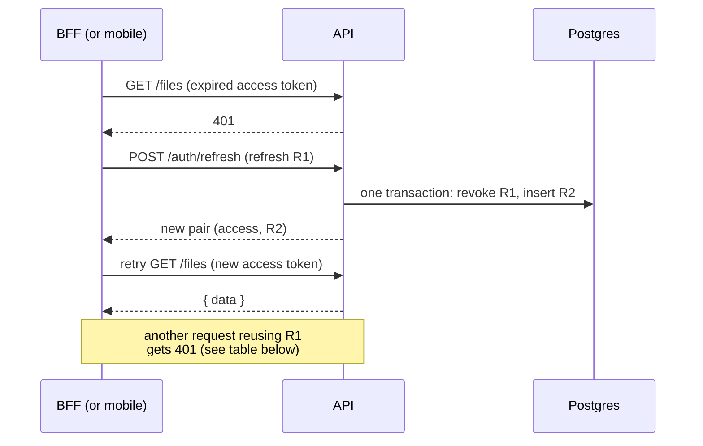

# Authentication

## Tokens

- **Access token**: JWT, HS256 only, lifetime `JWT_ACCESS_TTL` (15 minutes by default).
- **Refresh token**: opaque random value; only its SHA-256 hash is stored in
  `sessions`. Lifetime `JWT_REFRESH_TTL` (30 days).

`JwtAuthGuard` loads the user from the database on every authenticated
request:

- a blocked or deleted user is rejected at once;
- the role comes from the database, not the token, so a demotion applies on the next request;
- a token issued before `users.tokens_valid_after` is rejected. Password reset,
  password change and blocking set that column, so every access token already
  in circulation dies immediately instead of living out its 15 minutes.

## Account flows

| Flow            | Route                        | What happens                                                                                                                    |
| --------------- | ---------------------------- | ------------------------------------------------------------------------------------------------------------------------------- |
| Sign up         | `POST /auth/register`        | creates a `USER`, returns a session. Off when `ALLOW_REGISTRATION=false`. Duplicate email → 409                                 |
| Sign in         | `POST /auth/login`           | returns a session                                                                                                               |
| Forgot password | `POST /auth/forgot-password` | always 202. If the account exists and is active, stores a hashed token and queues a mail to `${WEB_URL}/reset-password?token=…` |
| Reset password  | `POST /auth/reset-password`  | consumes the token (single use, one hour), sets the password, revokes every session and access token                            |
| Change password | `POST /auth/change-password` | checks the current password, revokes everything, returns a fresh session for the caller                                         |
| Profile         | `GET` / `PATCH /auth/me`     | read the user, update `displayName`                                                                                             |
| Sign out        | `POST /auth/logout`          | revokes the session of that refresh token                                                                                       |

The forgot-password answer never says whether an email is registered. The
reset token and its mail are written in one transaction, so a mail is never
queued for a token that was not stored.

## Refresh rotation

`POST /auth/refresh` revokes the presented session and creates its successor in
one transaction (`AuthRepository.rotateSession`). Only one of several
concurrent requests can win:

| Situation                                              | Response                                                      |
| ------------------------------------------------------ | ------------------------------------------------------------- |
| token is current                                       | 200 with a new pair                                           |
| token was rotated less than 10 s ago (concurrent tabs) | 401 `AUTH_SESSION_ROTATED`; the winner keeps working          |
| token was rotated earlier (replay)                     | 401 `AUTH_TOKEN_REUSED`; every session of the user is revoked |

## Rate limits

Login, register, forgot-password and reset-password share two buckets:

| Bucket    | Key        | Limit             |
| --------- | ---------- | ----------------- |
| `client`  | IP + email | 10 per minute     |
| `account` | email only | 50 per 15 minutes |

The account bucket does not depend on the IP, so rotating `X-Forwarded-For`
cannot get around it. Reset-password has no email in its body and uses the
client bucket only. Set `TRUST_PROXY` to the proxies that may set
`X-Forwarded-For`, or every request looks like it comes from the proxy.

## Clients

- **Web and admin**: the browser never sees tokens. `@lean/next-bff` keeps them
  in `httpOnly`, `SameSite=Lax` cookies (`Secure` in production) whose
  lifetimes follow the TTLs, refreshes on 401 and retries once, and rejects
  cookie-authenticated writes whose `Origin` is not `WEB_ORIGIN` / `ADMIN_ORIGIN`.
  See [Web and admin](./frontends).
- **Mobile**: the refresh token lives in `flutter_secure_storage`; see [Mobile](./mobile).
