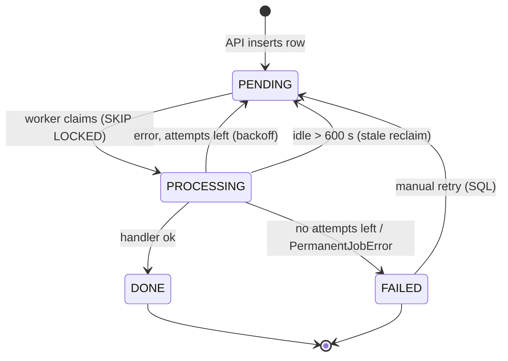

# Jobs and worker

Jobs are rows in the `jobs` table. The API inserts them; `apps/worker` claims
them with `FOR UPDATE SKIP LOCKED`, so several workers can run side by side
without Redis.

## Lifecycle



- Default budget: 5 attempts (`max_attempts`).
- Backoff: 15 s × 2^attempts, capped at 300 s.
- A `PROCESSING` row idle for more than 600 s (`JOB_LOCK_TIMEOUT_SECONDS` in
  `packages/db/src/jobs.ts`) is reclaimed, or failed if it has no attempts
  left. A stale worker cannot overwrite the result of a newer claim.
- Unknown job types and invalid payloads throw `PermanentJobError` and fail
  immediately without retries.
- The worker claims 5 jobs at a time and sleeps 500 ms when the queue is empty.
  On SIGTERM or SIGINT it stops claiming, finishes the batch in hand and exits.

## Job types

| Type        | Payload                 | Effect                    | Queued by                          |
| ----------- | ----------------------- | ------------------------- | ---------------------------------- |
| `demo.echo` | any JSON                | returns the payload       | admin Jobs page                    |
| `demo.fail` | any JSON                | always fails (retry demo) | admin Jobs page                    |
| `mail.send` | `{ to, subject, text }` | sends through `SMTP_URL`  | forgot-password, `POST /mail/send` |

## Add a job type

1. Add a handler to `apps/worker/src/handlers.ts`. Validate the payload and
   throw `PermanentJobError` when it can never succeed.
2. Add the type to `JOB_TYPES` in `apps/api/src/modules/jobs/jobs.dto.ts` if
   admins may enqueue it from the API.
3. From a feature, enqueue through the exported `JobsService`, inside the same
   `DatabaseService.transaction` as the write that needs it.
4. Add a spec under `apps/worker/src/__tests__/`.

## Operations

Process the queue once and exit (handy in scripts and while debugging a handler):

```bash
bun run --filter @lean/worker run:once
```

Run more workers to go faster; `SKIP LOCKED` keeps them from taking the same row:

```bash
docker compose -f compose.prod.yaml --env-file .env.production up -d --scale worker=3
```

Inspect the queue (the admin **Jobs** page shows the same data):

```sql
SELECT status, count(*) FROM jobs GROUP BY status;
SELECT id, type, attempts, last_error, updated_at FROM jobs
WHERE status = 'FAILED' ORDER BY updated_at DESC LIMIT 20;
```

Retry failed jobs after fixing the cause (for example a wrong `SMTP_URL`):

```sql
UPDATE jobs SET status = 'PENDING', attempts = 0, run_at = now(), last_error = NULL
WHERE status = 'FAILED' AND type = 'mail.send';
```

A worker killed mid-job leaves its rows in `PROCESSING`; they return to
`PENDING` automatically after the 600 s lock timeout. Do not reset them by hand
while a worker might still be running them.

Old rows are not deleted automatically. Prune them on a schedule if the table grows:

```sql
DELETE FROM jobs WHERE status = 'DONE' AND updated_at < now() - interval '30 days';
```
